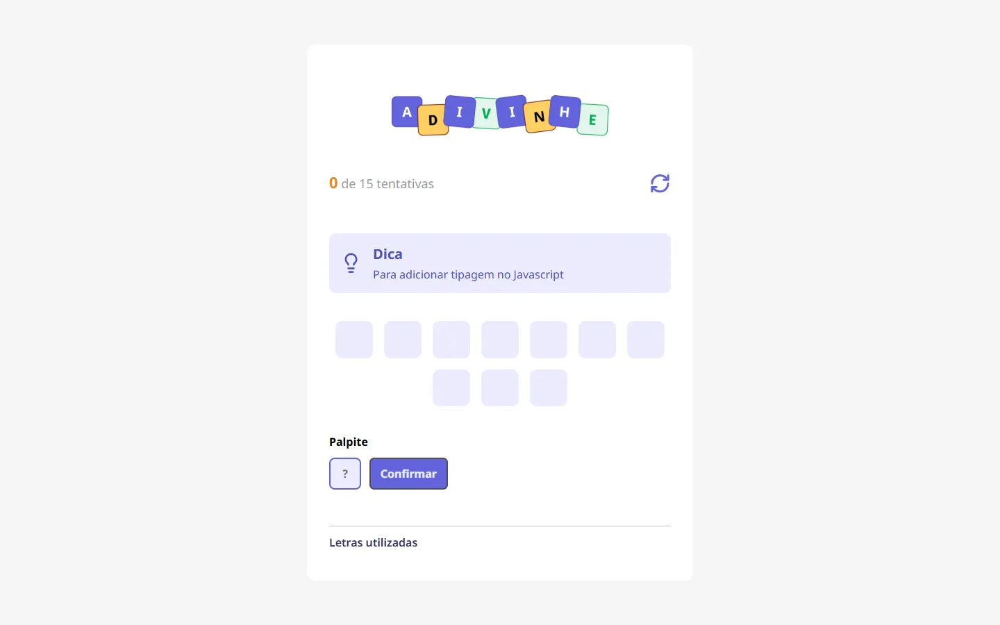
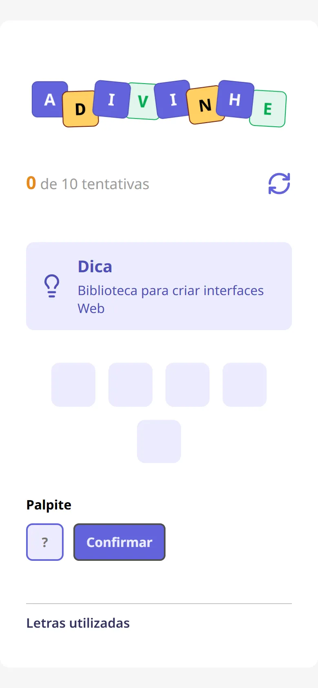

<div align="center">
  <h1>Adivinhe — Jogo de Adivinhação</h1>
  <p><strong>Jogo de palavras no estilo forca: leia a dica e descubra a palavra, letra por letra.</strong></p>
  <p>
    
    
    
    
    <a href="LICENSE"></a>
    <br>
    <a href="https://kevinlopes23.github.io/Jogo-de-Advinhacao/"></a>
  </p>
</div>

<p align="center">
  
  
</p>

## 💡 Sobre

O **Adivinhe** sorteia uma palavra e mostra uma dica sobre ela. O jogador chuta uma letra por vez: os acertos vão aparecendo na palavra e todas as letras usadas ficam marcadas em verde (acerto) ou amarelo (erro). O limite de tentativas é o tamanho da palavra + 5. Projeto de estudo para praticar componentes, props e estado com React e TypeScript.

## ✨ Funcionalidades

- Palavra e dica sorteadas a cada partida (tema: tecnologias web)
- Contador de tentativas com limite dinâmico (tamanho da palavra + 5)
- Lista de letras utilizadas, coloridas por acerto/erro
- Aviso ao repetir uma letra
- Mensagem de vitória ou derrota e nova partida automática
- Botão de reiniciar com confirmação
- Componentes reutilizáveis: `Header`, `Tip`, `Letter`, `LetterUsed`, `Input` e `Button`
- Deploy automático no GitHub Pages via GitHub Actions

## 🛠️ Tecnologias

- [React 19](https://react.dev/)
- [TypeScript](https://www.typescriptlang.org/)
- [Vite](https://vite.dev/)
- CSS Modules

## 🚀 Como rodar

Requer Node.js 20 ou superior.

```bash
git clone https://github.com/KevinLopes23/Jogo-de-Advinhacao.git
cd Jogo-de-Advinhacao
npm install
npm run dev        # http://localhost:5173/Jogo-de-Advinhacao/
```

```bash
npm run build      # checa os tipos e gera dist/
npm run preview    # serve o build localmente
```

Para adicionar palavras, edite o array `WORDS` em `src/utils/words.ts` (cada item tem `word` e `tip`).

## 📁 Estrutura

```
src/
├── components/   Header, Tip, Letter, LetterUsed, Input, Button
├── utils/        words.ts (lista de palavras e dicas)
├── assets/       logo e ícones
├── App.tsx       estado e regras do jogo
└── main.tsx      ponto de entrada
```

## 📄 Licença

Distribuído sob a licença [MIT](LICENSE).

## 👤 Autor

Feito por [Kevin Lopes](https://github.com/KevinLopes23).
